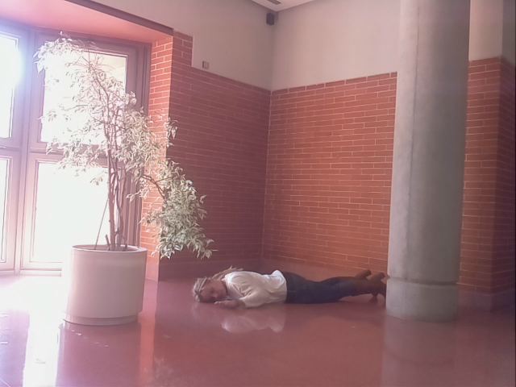
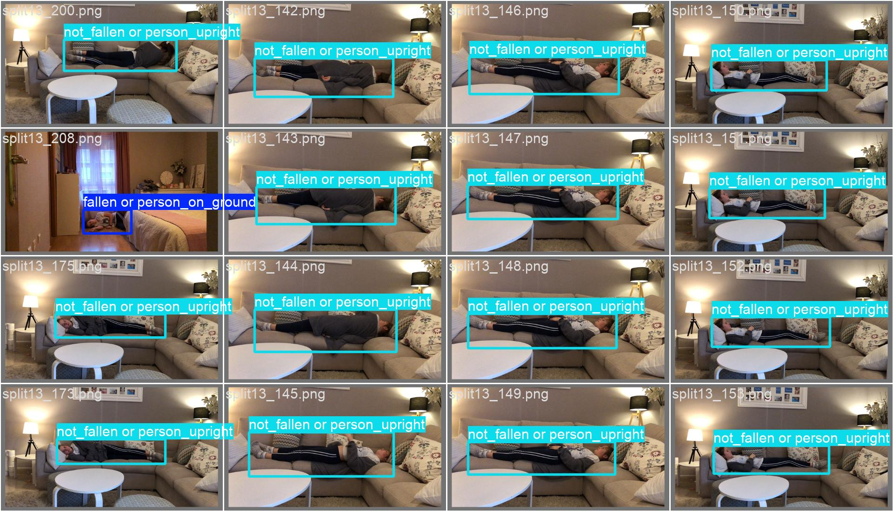

# Fallen Person Detector

Automated detection of falls and slips can be instrumental for providing rapid responses in assistive living facilities, hospitals, nursing homes, rehabilitation centers, and other places where injury due to falling over is common.

This repo has code for fine-tuning the YOLO-World model, an Open-Vocabulary detection model. The fine-tuning script also compares the fine-tuned model to the baseline YOLO-World model.

*example image from dataset*

# Dataset

Used is the FPDS Dataset from https://gram.web.uah.es/data/datasets/fpds/index.html

You have to download the test, train, and valid datasets and move them into a 'data' folder to run the convert_fpds_to_yolo script 

# Results

| Evaluation  | Precision  |  Recall  |
|---|---|---|
| Before training/validation set  |  0.546 | 0.819|
| After training/validation set  | 0.813  | 0.717|
|  After training/test set | 0.793  |   0.740|

*Dataset includes distinction between a person safely lying down on furniture vs a person having fallen down onto the ground*

# Thoughts

The sharp precision increase yet decline in recall is likely due to the default optimizer chosen by Ultralytics. Regardless, the result of the fine-tuning is a model that is more often correct when it predicts a fallen person. In the context of reading a stream of security camera frames, this tradeoff may be advantageous since the model will have many frames to detect a person having fallen over or not. A few missed detections is not as big of a deal in the context of a whole video stream.

# Next Steps

For this to be ready for real-world deployment, further fine-tuning should be done with data collected at the site of the security camera. That would include going on-site and collecting photos of multiple different people lying on the ground "fallen" and also just standing upright.
 
Additionally, a threshold for "fallen person" frames needs to be decided i.e., if there are 15 'fallen' frames of the past 45 frames for a 30FPS camera, then alert an employee. 15 and 45 would be optimized to avoid frequent false positives.

